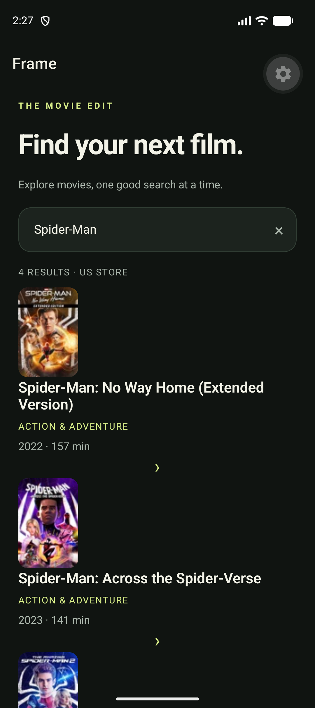
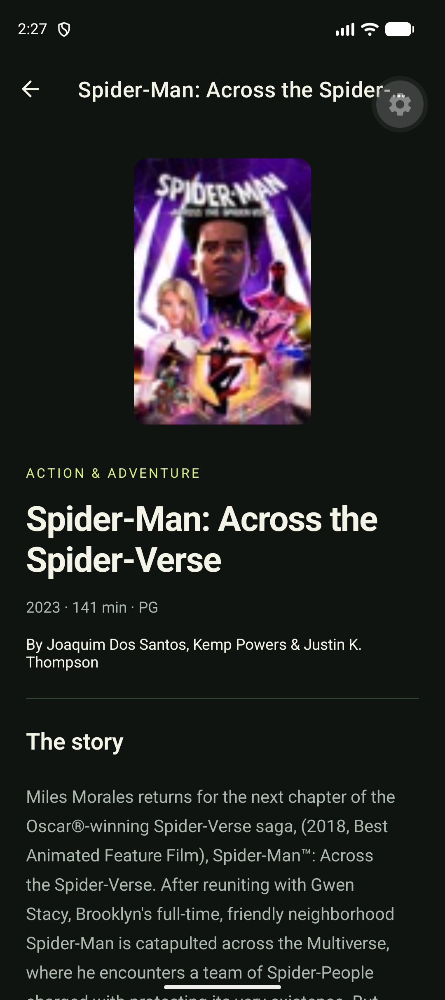

# Frame — React Native movie reference

A two-screen Expo + TypeScript app for studying code challenge architecture. Search movies through Apple's iTunes API, then open a movie's details. No API key or backend required.

## Screenshots

Captured from the running app on the Pixel_10 Android emulator using Expo Go. The floating tools button belongs to Expo Go.

| Movie search | Movie details |
| --- | --- |
|  |  |

## Run

Requires Node 22.13+ and npm. From this directory:

```sh
npm ci
npm start
```

Scan the QR code with a compatible Expo Go release. Press `a` for an Android emulator or `i` for an iOS simulator (macOS required). `npm run web` opens the browser version; native iOS/Android are the primary targets. The generated starter uses Expo SDK 58; Expo Go must support that SDK.

## Architecture

```text
src/app/                           Route declarations and app composition
  _layout.tsx                      Query provider and native stack
  index.tsx                        Search route
  movie/[id].tsx                   Details route
src/
  features/movies/
    api/                           Apple response validation and mapping
    model/                         UI-facing Movie type
    hooks/                         Query keys and server-state hooks
    components/                    Movie card and artwork
    screens/                       List and details composition
  shared/
    api/                           HTTP status, cancellation, timeout handling
    hooks/                         Reusable debounce
    ui/                            Theme tokens and async-state UI
```

Data flows from route → screen → query hook → API → HTTP. API responses are `unknown` until checked at the boundary. Screens never read Apple's `trackName` or `trackTimeMillis` directly. This keeps vendor details out of presentation code.

Local search input stays in React state. TanStack Query owns asynchronous server state, caching and request deduplication. Navigation owns the selected ID. A separate global store, repository interface and use-case classes would add little value to these two screens, so they are intentionally omitted. Add interfaces when there are multiple data sources or business rules that need them.

## Behavior and decisions

- Starts with a **Batman search**, not a trending feed: iTunes search requires a term.
- Search trims input, waits 500 ms and requires two characters. Results disappear while the input changes so an old result isn't labeled with a new search term.
- Queries include the storefront and term/ID in their keys. Results stay fresh for 5 minutes and unused entries expire after 30 minutes. Cache is in memory only.
- The AbortSignal is forwarded into fetch, with a 15-second timeout. Query keys isolate responses from rapid searches.
- One retry for network/server errors; no automatic retry for HTTP 4xx, including 429. Explicit retry remains available.
- Both endpoints use **US** consistently. Change `STORE_COUNTRY` in `movies-api.ts` to use another storefront; availability varies.
- Search requests up to 50 movies. No pagination is claimed: this sample does not implement a documented cursor-based paging API.
- Details loads `/lookup?id=…` independently. Opening a direct movie link works without a list in memory; navigation passes only an ID.
- Loading, empty, invalid-link, unavailable-movie, request-error and retry states are explicit. Existing data remains visible if a background refresh fails.
- Missing artwork, synopsis, runtime and price have safe handling. Artwork uses the documented URL unchanged; its low resolution is an API limitation.
- Lists use FlatList, stable IDs and accessible controls. Details scrolls and respects safe areas.
- The Apple TV link opens externally and handles link failures. No preview playback is included.

## Validate

```sh
npm run typecheck
npm run lint
npm test
npm run format:check
npx expo install --check
npx expo export --platform android
```

Tests exercise mapping, filtering, URL encoding, malformed responses, empty lookups, HTTP failures, cancellation and timeouts. They use mocked transport and do not depend on live API uptime.

Manual device checklist: search a title; type quickly; clear input; search gibberish; disconnect networking and retry; open details and navigate back; open a direct `/movie/42` route; verify large text and screen-reader labels; open the store link. Native visual/device validation must be done on a running emulator or device.

## Interview walkthrough

1. Explain the data flow and why server state differs from local input state.
2. Show the boundary mapper and how it prevents optional API fields from leaking into screens.
3. Discuss debounce vs cancellation vs caching: they solve different problems.
4. Explain why details loads by ID and why navigation doesn't serialize a movie object.
5. Demonstrate an error and retry, then walk through the tests.
6. Discuss extensions only when asked: persisted cache, connectivity awareness, richer validation, component tests and analytics.

## API references

- [Apple iTunes Search API documentation](https://performance-partners.apple.com/search-api)
- [Example movie-only search](https://itunes.apple.com/search?term=batman&media=movie&entity=movie&country=US&limit=50)

Apple documents an approximate 20 requests/minute limit, subject to change. Debouncing and caching reduce calls but do not guarantee staying below the service limit. Metadata and artwork belong to their owners; review Apple's promotional-content terms before distributing a production app.

## Verification notes

TypeScript, ESLint, formatting, 10 unit tests and the Android production bundle export passed during creation. Native UI and live API behavior still require device testing. `npm audit` reports 21 advisories (14 high, 7 moderate) in the generated Expo/React Native dependency tree. No forced major-version downgrade or unverified transitive override was applied.

### Empty filtered searches

Live checks found movie-filtered searches returning zero results while broad searches returned movies. When the filtered response is empty, the app retries a broad search and filters `feature-movie` records locally. This costs one additional request; broad results can contain fewer movies because other media share the result limit. Details lookup uses ID and country without an entity filter. Development builds log API URLs, HTTP status, duration and JSON responses to Metro with the `[API]` prefix.
